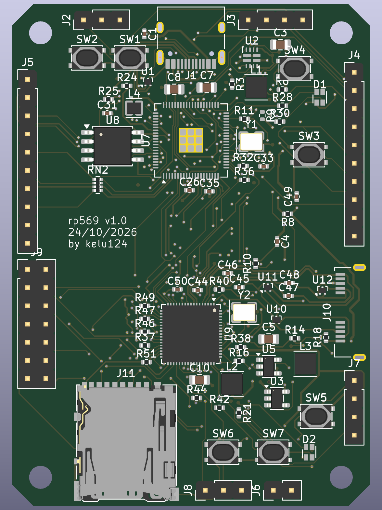
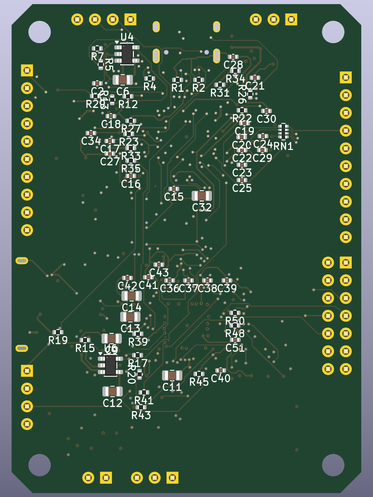

# rp569

An open hardware board (KiCad) that pairs a **Raspberry Pi RP2350B** with a **WCH CH569W**.
The RP2350B generates high-speed data and the CH569 streams it to a host over **USB 3.0**.

Status: **v1.0** (tag `v1.0`). Schematic complete, PCB **fully routed** (4-layer, 50×70 mm, chamfered corners,
parts on both sides; 0 unconnected, 0 DRC errors) and **JLCPCB production files generated**. Before ordering:
USB pairs as coupled pairs, silkscreen cleanup, impedance check (see [`docs/layout.md`](docs/layout.md)).
[Schematic PDF](hardware/rp569-schematic.pdf).

## Production files (JLCPCB)

| File | Use |
|---|---|
| [`hardware/jlcpcb/rp569-gerbers.zip`](hardware/jlcpcb/rp569-gerbers.zip) | PCB order (gerbers + drill) |
| [`hardware/jlcpcb/rp569-bom.csv`](hardware/jlcpcb/rp569-bom.csv) | Assembly BOM with LCSC part numbers |
| [`hardware/jlcpcb/rp569-cpl.csv`](hardware/jlcpcb/rp569-cpl.csv) | Assembly placement (CPL) |

Board to fabricate: [`hardware/rp569-routed.kicad_pcb`](hardware/rp569-routed.kicad_pcb). Regenerate the files
with `python3 hardware/gen/gen_fab.py`. Two parts are not stocked by JLCPCB and must be consigned: CH569W and the
Amphenol GSB343K33HR USB3 connector ([`docs/bom.md`](docs/bom.md)).

| Top | Bottom |
|---|---|
|  |  |

## Features

| Block | RP2350B | CH569W |
|-------|---------|--------|
| USB | USB 2.0 on USB-C (firmware, debug, test control) | USB 3.0 SuperSpeed, Micro-B connector |
| Storage | QSPI flash | SD card on the eMMC/SD controller |
| User I/O | RGB LED, 2 user buttons | RGB LED, 2 user buttons |
| Boot | BOOTSEL + RUN buttons | BOOT button + jumper (force the USB bootloader on a blank chip) |
| Breakout | I2C header for extra devices | I2C header (bit-banged GPIO) |

**Logic analyser**: 8 input pins on the RP2350B are sampled by PIO and streamed over the
parallel bus to the CH569, then to the host over USB 3.

**Power**: the RP2350B runs from either USB connector through a TI TPS2121 power mux, so neither back-feeds the
other. The CH569 is powered from its own USB3 VBUS through a load switch that the RP2350B controls, so
it can be power-cycled and forced into its bootloader during automated tests.

**Links between the two chips**
- 8-bit parallel bus with clock and handshake lines (8-bit because the CH569's 16-bit mode shares pins with the SD card; see [`specification.md`](specification.md) D-003): RP2350B PIO sends, CH569 HSPI receives.
- Shared I2C bus.
- UART.
- CH569 RESET# and boot-mode pins driven by the RP2350B, so the CH569 can be reflashed and
  power-cycled automatically during testing.

## Repository layout

| Path | Content |
|------|---------|
| `hardware/` | KiCad project, generated from `hardware/gen/board.py` (run `hardware/gen/build.sh`); `rp569-routed.kicad_pcb` = routed v1.0 board |
| `hardware/jlcpcb/` | JLCPCB production files: gerbers zip, BOM, CPL |
| `datasheet/` | Datasheets as PDF and Markdown (see `datasheet/README.md`) |
| `docs/` | `pinmap.md` (RP2350B ↔ CH569 pin map), `power.md`, `layout.md`, `bom.md` (JLCPCB BOM), `ch569-hardware-notes.md` |
| `project/` | Reference projects: [HydraUSB3](https://github.com/hydrausb3), [phantomdrive](https://github.com/o7-machinehum/phantomdrive) (see `project/README.md`) |
| `specification.md` | Requirements (R-xx) and design decisions (D-xxx) |
| `CLAUDE.md`, `.claude/` | Project context, todo/done logs, commit log |

## References

- [HydraUSB3](https://github.com/hydrausb3): open-source CH569 dev kit, firmware and HSPI/USB3 drivers.
- [phantomdrive](https://github.com/o7-machinehum/phantomdrive): open-source CH569W encrypted USB3 drive with SD card, KiCad sources.
- [RP2350 datasheet](https://datasheets.raspberrypi.com/rp2350/rp2350-datasheet.pdf) and
  [hardware design guide](https://datasheets.raspberrypi.com/rp2350/hardware-design-with-rp2350.pdf).
