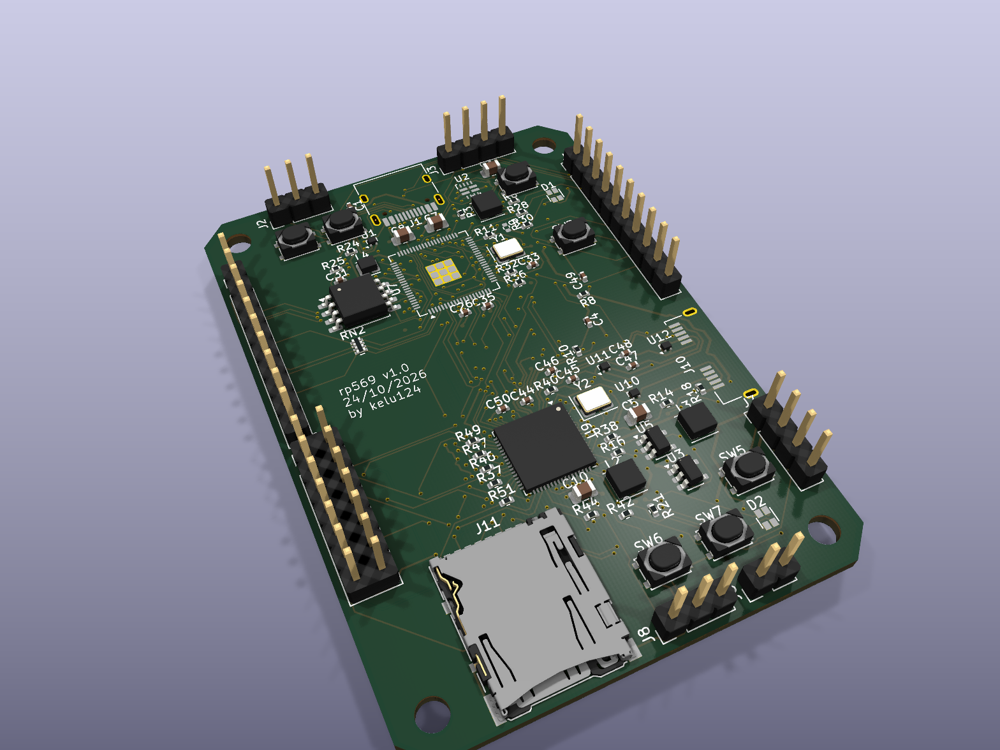
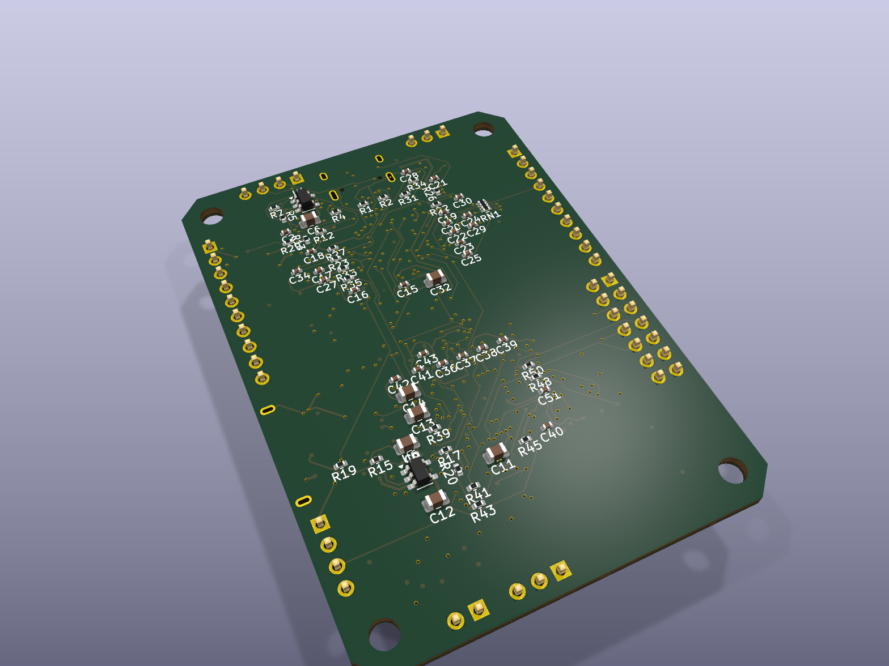
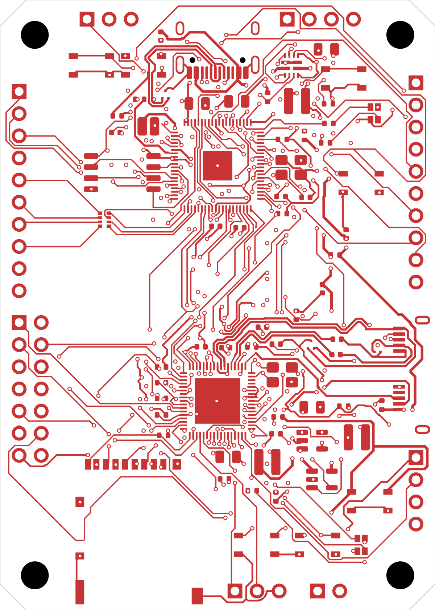
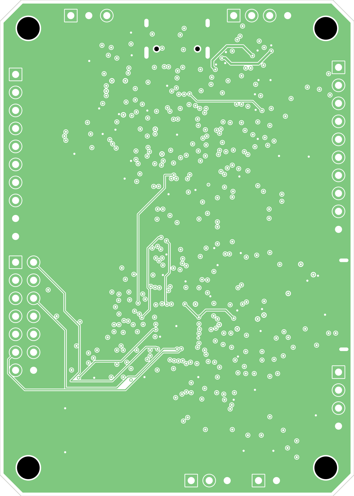
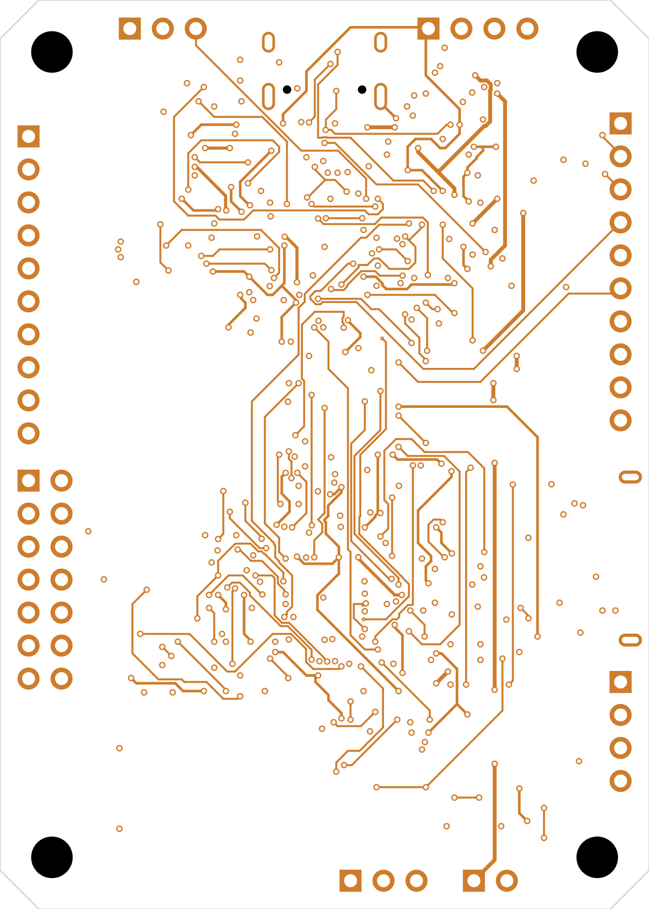
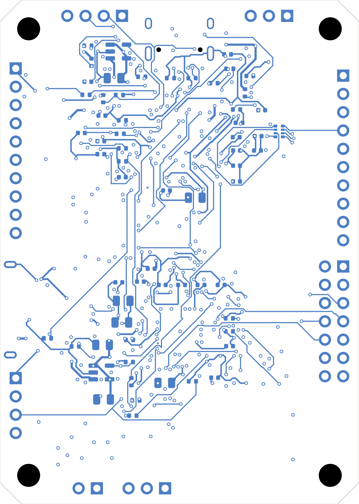

# Board images (v1.0)

Generated by `python3 hardware/gen/gen_renders.py` from `hardware/rp569-routed.kicad_pcb` (re-run after board changes).

| Top | Bottom |
|---|---|
|  |  |
|  |  |

Layer plots (board area, bottom layers mirrored as seen from below), SVG + PNG:

| F.Cu | In1.Cu (GND plane) | In2.Cu | B.Cu |
|---|---|---|---|
|  |  |  |  |

Assembly views (silkscreen + fab): [top](rp569-v1.0-assembly-top.png), [bottom](rp569-v1.0-assembly-bottom.png).
