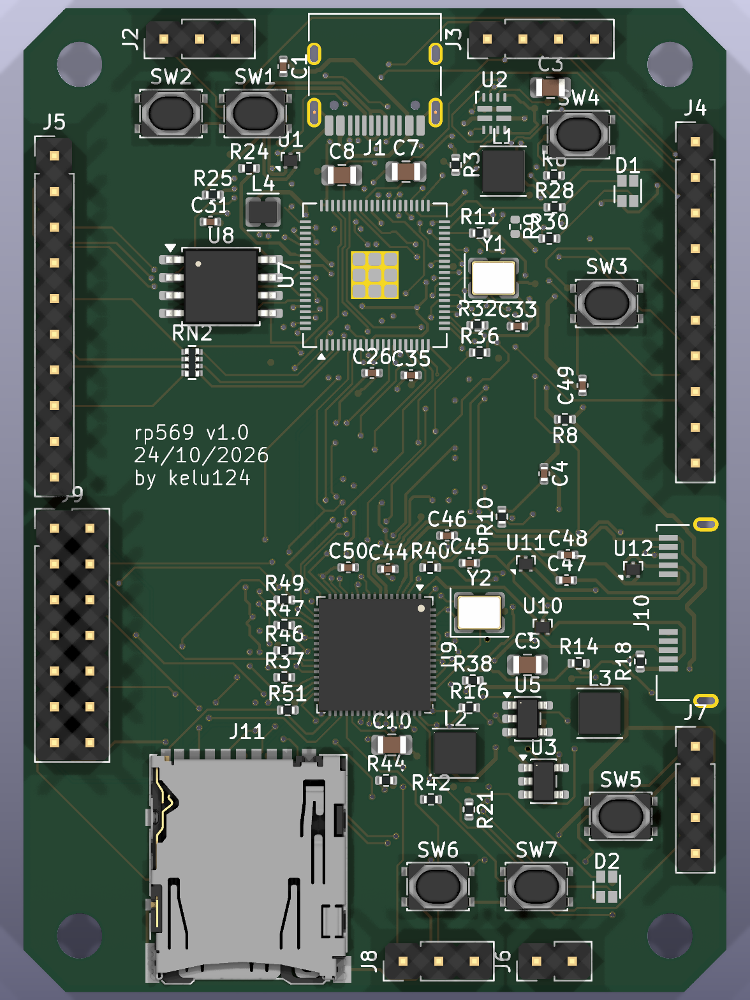
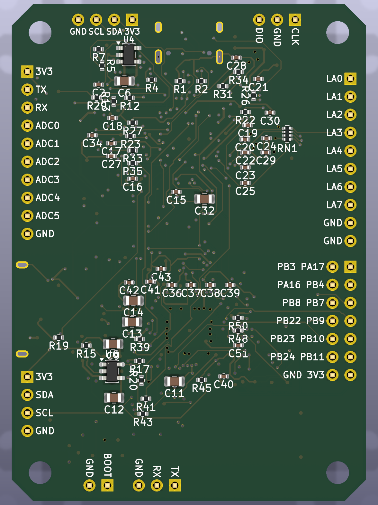

# rp569 — RP2350B × CH569, USB 3.0 for PIO

An open-hardware board (KiCad) that pairs a **Raspberry Pi RP2350B** with a **WCH CH569W**. The RP2350B generates
or samples data with its PIO blocks; the CH569 receives it over an 8-bit parallel bus (HSPI) and streams it to a
host over **USB 3.0 SuperSpeed**.

**Status: v1.0** — schematic complete, PCB fully routed (4 layers, 50 × 70 mm, 0 unconnected, 0 DRC errors),
JLCPCB production files generated. Not fabricated yet. First firmware for both chips (builds, untested on hardware):
[firmware/](https://github.com/kelu124/rp569/tree/main/firmware).
[Source on GitHub](https://github.com/kelu124/rp569).

| Top | Bottom |
|---|---|
|  |  |

## What it does

| Block | RP2350B | CH569W |
|---|---|---|
| USB | USB 2.0 on USB-C (firmware, debug, test control) | USB 3.0 SuperSpeed, Micro-B with through-hole legs |
| Storage | 16 MB QSPI flash | microSD (4-bit) on the eMMC/SD controller |
| User I/O | RGB LED, 2 buttons, I2C header, 1x10 header (ADC, debug UART) | RGB LED, 2 buttons, I2C header, 2x07 header (12 GPIO) |
| Boot | BOOTSEL + RUN | BOOT button + jumper (blank chip) |

- **Inter-chip links**: 8-bit HSPI bus with clock and handshake, shared I2C, UART.
- **Logic analyser**: 8 RP2350 inputs (GPIO0–7) sampled by PIO and streamed over HSPI → USB 3.
- **Test automation**: the RP2350 switches the CH569's power, drives its reset and its boot pin, so the CH569 can
  be power-cycled and reflashed over USB without touching the board.
- **Power**: USB-C and USB3 VBUS combined by a TI TPS2121 power mux (no back-feed); the CH569 has its own
  switched supply.

## Documentation

| Page | Content |
|---|---|
| [Architecture](architecture.md) | Block diagram, inter-chip links, power and boot control |
| [Pin map](pinmap.md) | Every RP2350B ↔ CH569 pin, with datasheet references |
| [Power](power.md) | Power paths, TPS2121 mux, CH569 load switch, rails |
| [Layout and routing](layout.md) | How the KiCad files are generated, placement, net classes, routing (Freerouting / KiCadRoutingTools) |
| [Bill of materials](bom.md) | JLCPCB parts with LCSC numbers, stock, consigned parts |
| [Production](production.md) | Ordering at JLCPCB: files, settings, checklist |
| [Images](images/) | 3D renders, layer plots, assembly views |
| [CH569 hardware notes](ch569-hardware-notes.md) | Notes from the CH569 datasheet and reference designs |
| [Hackaday drafts](hadposts/) | Project-log drafts |
| [Firmware](https://github.com/kelu124/rp569/tree/main/firmware) | RP2350B command line and CH569 USB3 firmware: build, flash, bring-up |

Requirements and design decisions (R-xx, D-xxx) are in
[specification.md](https://github.com/kelu124/rp569/blob/main/specification.md) at the repository root.

## Downloads

| File | |
|---|---|
| [rp569-gerbers.zip](https://github.com/kelu124/rp569/raw/main/hardware/jlcpcb/rp569-gerbers.zip) | Gerbers + drill files (JLCPCB) |
| [rp569-bom.csv](https://github.com/kelu124/rp569/blob/main/hardware/jlcpcb/rp569-bom.csv) | Assembly BOM with LCSC part numbers |
| [rp569-cpl.csv](https://github.com/kelu124/rp569/blob/main/hardware/jlcpcb/rp569-cpl.csv) | Assembly placement |
| [Schematic (PDF)](https://github.com/kelu124/rp569/blob/main/hardware/rp569-schematic.pdf) | |
| [KiCad board](https://github.com/kelu124/rp569/blob/main/hardware/rp569-routed.kicad_pcb) | Routed v1.0 board (KiCad 10) |

## How the design is made

The KiCad project is generated from one Python file, `hardware/gen/board.py` (parts, footprints, pin→net map):
`hardware/gen/build.sh` writes the schematic, the placed PCB and the net classes and runs ERC/DRC. Routing used
KiCadRoutingTools (`hardware/gen/route_krt.sh`), finished by hand in pcbnew. `hardware/gen/gen_fab.py` writes the
production files and `hardware/gen/gen_renders.py` the images. Details: [Layout and routing](layout.md).

## References

- [HydraUSB3](https://github.com/hydrausb3) — open-source CH569 dev kit, firmware and HSPI/USB3 drivers.
- [phantomdrive](https://github.com/o7-machinehum/phantomdrive) — open-source CH569W USB3 drive with SD card.
- [RP2350 datasheet](https://datasheets.raspberrypi.com/rp2350/rp2350-datasheet.pdf) and
  [hardware design guide](https://datasheets.raspberrypi.com/rp2350/hardware-design-with-rp2350.pdf).
- [KiCadRoutingTools](https://github.com/drandyhaas/KiCadRoutingTools), [Freerouting](https://github.com/freerouting/freerouting).
