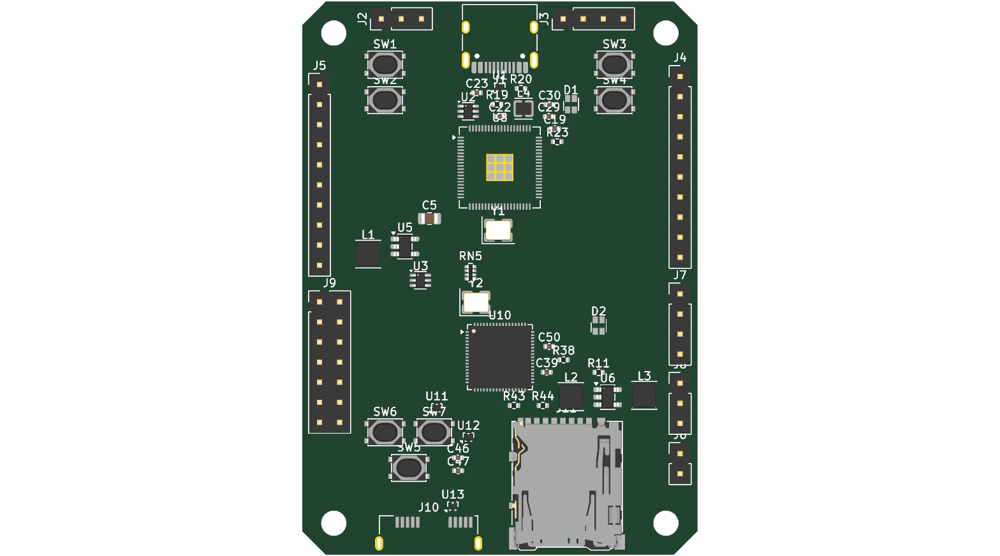
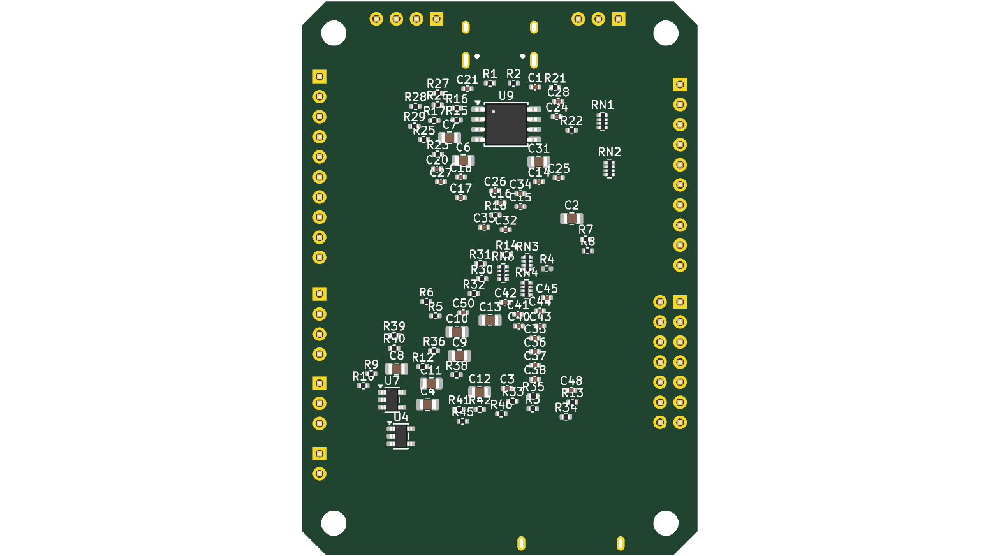

# Layout status

Status: **v0.2, 2026-10-23. Schematic complete, PCB placed (50×70 mm, two-sided), NOT routed.**

| Top | Bottom |
|---|---|
|  |  |

## How the KiCad files are produced

Everything under `hardware/` is generated from `hardware/gen/board.py` (parts, footprints, pin→net map):

| Script | Output |
|---|---|
| `gen/mk_lib.py` | `lib/rp569.kicad_sym`: CH569W symbol from phantomdrive (MIT), pin types corrected |
| `gen/gen_sch.py` | `rp569.kicad_sch`: one sheet, symbols grouped by block, a net label on every pin |
| `gen/gen_pcb.py` | `rp569.kicad_pcb`: 4-layer 50×70 mm with 3 mm chamfered corners, footprints + nets, fixed connectors/chips/buttons/LEDs, two-sided automatic placement, GND planes on In1/In2 |
| `gen/gen_pro.py` | net classes in `rp569.kicad_pro` (USB3_90R, USB2_90R, HSPI, Power) |
| `gen/build.sh` | runs all of the above, then ERC and DRC with schematic parity → `hardware/reports/` |

**Once hand-routing starts, stop running `gen_pcb.py`**: it rebuilds the board from scratch and would
wipe the routing. From then on, change `board.py` → `gen_sch.py` → in pcbnew *Tools → Update PCB from
Schematic*. Footprints are already linked to their symbols, and schematic parity is 0 issues.

## Check results (v0.2)

- ERC: 1 error, expected (two LM66100 outputs on 5V_SYS = ideal-diode OR).
- DRC: 0 electrical violations; ~200 silkscreen overlaps (cosmetic, to clean up); 415 unrouted connections.
- Schematic ↔ PCB parity: 0 issues.

## Placement summary (D-011)

Board 50×70 mm, portrait, 3 mm 45° chamfers, M3 holes 4 mm from each corner. The RP2350 half is at the top,
the CH569 half at the bottom, and the HSPI series arrays sit between the two chips.

- **Top side** (all fixed by `gen_pcb.py`): USB-C on the top edge, RP2350B at (25, 21), CH569W at (25, 45),
  USB3 Micro-B and microSD on the bottom edge. Each RGB LED is next to its chip (D1 by the RP2350, D2 by the
  CH569). Buttons: BOOTSEL/RUN top-left, RP BTN1/2 top-right, CH BTN1/2 + CH569 BOOT bottom-left.
  Regulators, inductors, crystals, USB ESD and the SSTX AC caps are also on top (USB parts are forced to top).
- **Bottom side**: most passives (decoupling caps under the IC pads, pull-ups, HSPI 33 Ω arrays) and the
  QSPI flash. The area under each chip's exposed pad is kept free for thermal vias.
- **Headers** (THT): top edge SWD + RP I2C; left edge LA IN (1x10) + CH EXT (2x07); right edge RP EXT
  (1x10, includes the RP debug UART) + CH I2C + CH UART + CH BOOT JP (2-pin jumper).

## To do before routing

1. **Stackup**: choose the fab (e.g. JLCPCB 4-layer JLC04161H-7628) and recompute the 90 Ω differential
   width/gap for USB3_90R / USB2_90R (placeholders are 0.15/0.15 mm).
2. Review the placement by hand. These were placed by an algorithm, not by engineering judgement:
   - RP2350 VREG loop: VREG_VIN cap, inductor and DVDD cap tight together (RP2350 datasheet,
     "External components and PCB layout requirements").
   - TLV62569 loops: CIN, SW node and inductor compact.
   - SuperSpeed AC caps and ESD close to the USB3 connector.
   - Crystals right next to their chips.
3. LED pinout: done (LiteOn LTST-C19HE1WT, checked against its datasheet, see `docs/bom.md`).
4. Silkscreen cleanup.

## Routing order (suggested)

1. USB3 SuperSpeed pairs (SSTX via AC caps, SSRX) and USB2 pairs: hand-routed on F.Cu over the In1 GND
   plane, length-matched within each pair, no vias if possible.
2. Power: VBUS → ideal diodes → bucks; RP2350 VREG; CH569 1V2/3V3 pours.
3. HSPI bus (16 lines through the 33 Ω arrays): matched lengths ±1 mm relative to HSPI_RCLK.
4. Everything else. Freerouting (not installed) could autoroute the low-speed nets after steps 1–3.
